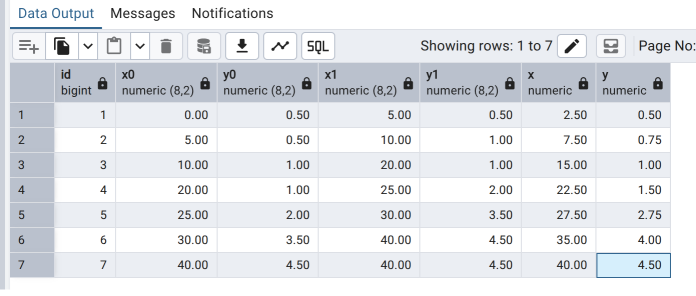

# Привет, бро!

Приглашаю тебя поучавствовать в `демо` показе нашего решения нашему **Заказчику**
Мы должны на него произвести **положительное** впечатление.

Нам необходимо показать ему рассчеты.
Заказчик очень хочет чтобы ему сформировали таблицу в следующем виде:

1. `Статистика расчетов интерполяции`
Необходимо сформировать и продемонстрировать Заказчику следующую таблицу.

| №   | x0  | y0  | x1 | y1 | x | y |
|-----|-----|-----|----|----|---|---|

Данные необходимо взять из таблицы 1 (`Технического задания`). X - это среднее арифметическое значение между x1 и x0.

Пример:

2. `Проверка корректности параметров`
Необходимо сформировать и продемонстрировать Заказчику следующую таблицу.

 | №  |  Тип оборудования | Высота метеопоста | Температура | Давление | Направление ветра | Скорость ветра | Дальность сноса пуль | Флаг: Есть ошибка | Описание ошибки |
 |----|-------------------|-------------------|-------------|----------|-------------------|-----------------|----------------------|------------|-----------------|

В качестве источника нужно заполнить корректными и некорректными данными исходные таблицы.

Спасибо. 
`Вся надежда лишь на тебя`